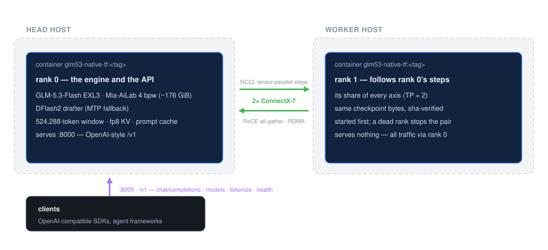
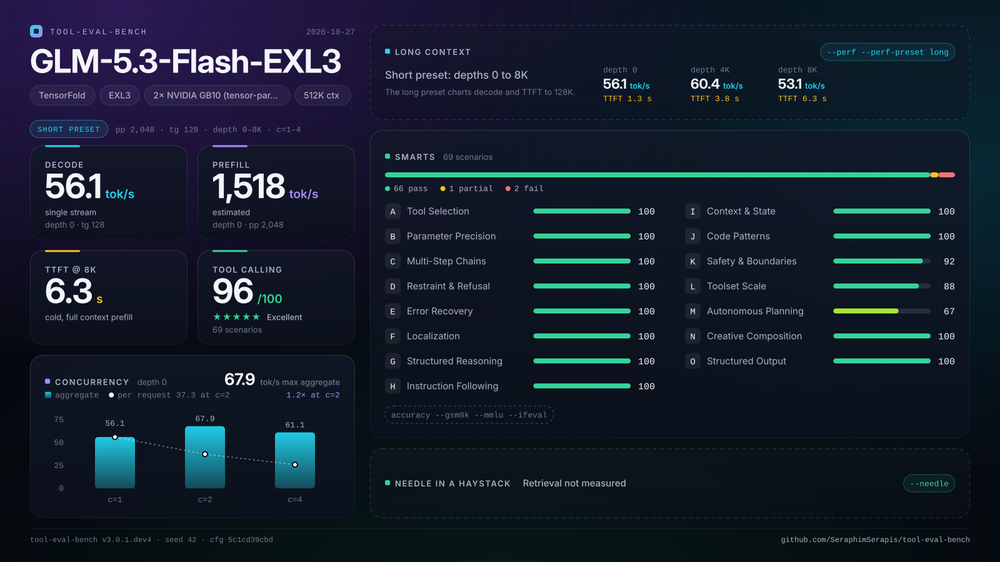
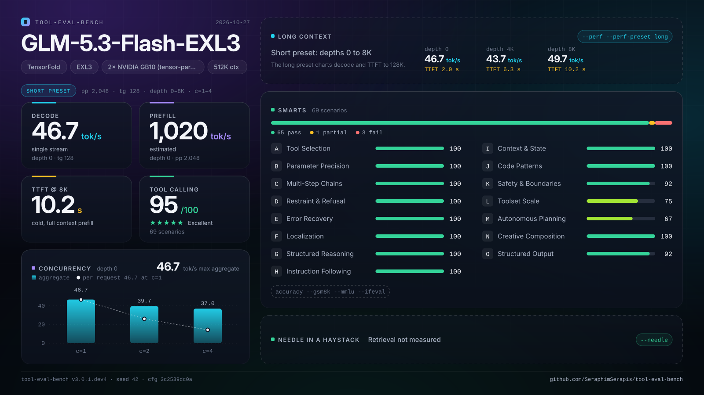
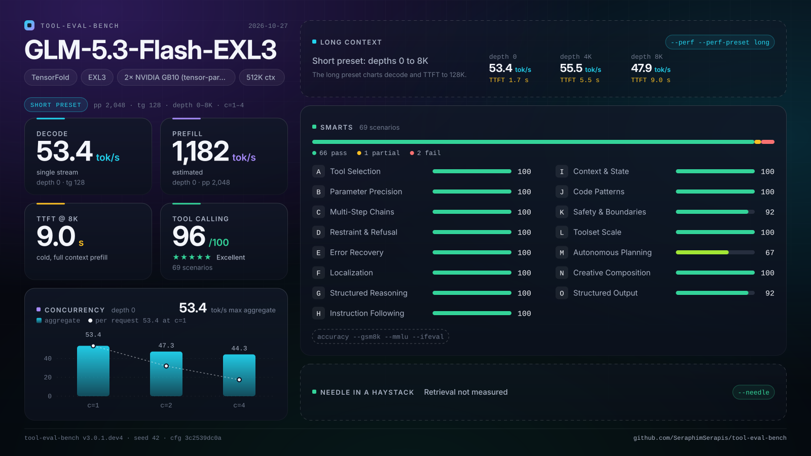
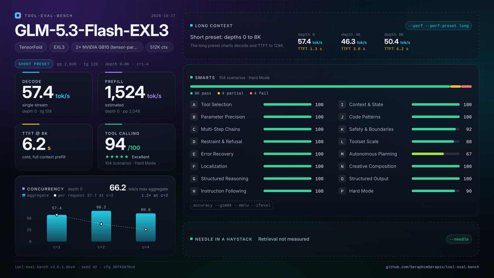
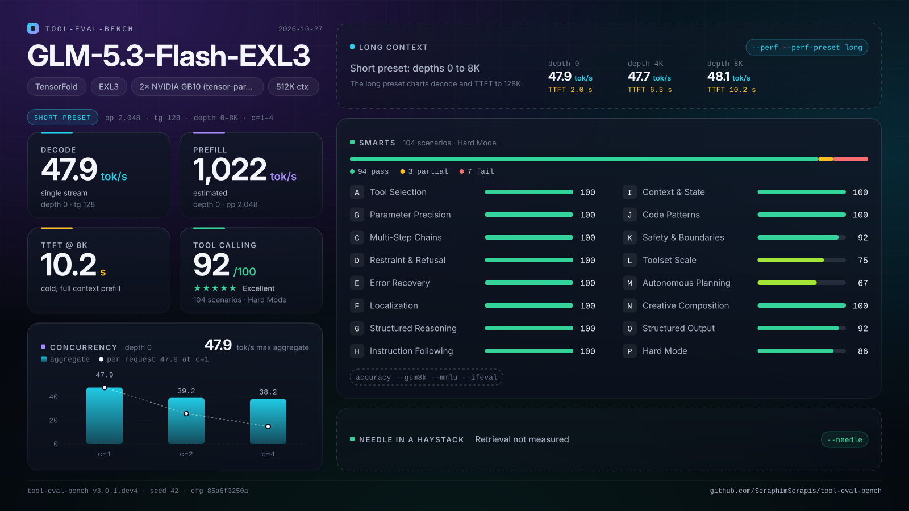
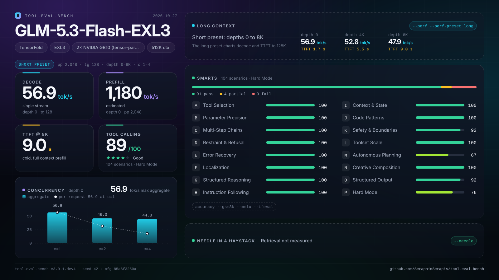

# GLM-5.3-Flash EXL3 on 2× GB10 — TensorFold native v1.1 (testing)

> ## 🤖 Provenance disclaimer
>
> **Every edit in this repository — code, scripts, and all documentation — was
> generated by an AI agent** (OpenCode running GLM, by Z.ai), working from measured
> receipts on the hardware this repo serves. Human review is the user's; the numbers
> come from the campaign runs under `results/` and the append-only log
> [docs/LAUNCH.md](docs/LAUNCH.md), not from imagination. Where a claim has no
> receipt behind it, the docs say so.

> ## ⚠️ Testing line — significantly different from the production recipe
>
> **This line is EXL3 only**: it serves Mia-AiLab's EXL3 checkpoint line (default: the
> site's **AZ-Focus** variant — topk=8 by design, the hardmode-quality leader) with the
> DFlash2 drafter (`--drafter`) on TensorFold's native
> CUDA engine — the two-rank path upstream measured for 1.1.0 and onwards. **The NVFP4
> route has its own repo**
> ([GLM-5.3-Flash-NVFP4-2x-GB10-TensorFold-v1-testing](https://github.com/gilesco/GLM-5.3-Flash-NVFP4-2x-GB10-TensorFold-v1-testing)),
> including its 1.1.0 vision bring-up; **vision here is unserved**: the engine code and
> the checkpoint's vision tower are both present (347 `model.visual.*` tensors), but this
> line passes no `--vision` and has no vision receipts — the two lines are otherwise
> not interchangeable (different checkpoint, different memory model, different receipts).
>
> This is **not** the EXL3/Python deployment: it serves the same checkpoint on the
> **native CUDA engine** (Zig, no Python, no patch stack). Production stays
> [MiaAI-Lab's EXL3 recipe](https://github.com/MiaAI-Lab/GLM-5.3-Flash-EXL3-2x-DGX-Sparks-TensorFold)
> — it remains the faster prefill and the quality reference — while this line carries the
> qualification work that lets the native engine serve.

One GLM-5.3-Flash instance, tensor-parallel over the ConnectX-7 link: rank 0 runs the
engine and the API, rank 1 holds its share of every axis and follows rank 0's steps over
NCCL. Everything is Docker; the hosts need nothing but docker, ssh and the NVIDIA driver.

<p align="center">
  
</p>

> The default port is **8000** — deliberately the same as the production EXL3 stack, so
> clients keep one endpoint when switching engines. The price is that the two stacks are
> mutually exclusive: `start.sh` refuses a busy port, so stop one before starting the other.

## Why this exists

- **Upstream instead of a patch fork**: the EXL3 recipe carries 122 patches against the
  Python engine (Mia's series folded onto the python-0.6 tip, 2026-10-27) and rebasing
  them is the slow part of every upgrade. This line runs upstream
  code at a pinned commit; a new v1.* release is a version bump and a rebuild.
- **Same checkpoint line as production, upstream's engine**: the EXL3 checkpoint line
  (production's Mia-AiLab snapshot, and AxonZeta's Focus variant — the default) with the
  DFlash2 drafter on the native engine — the two-rank GLM path upstream measured for
  1.1.0 and onwards (#855/#976, drafter in #979).
- **A qualification harness, not just a deployment**: one command runs the whole
  evidence chain — exactness gates, depth probes, tool-eval, throughput tables, the
  context ladder — with receipts, phase markers, and a production guard.

## Status: the Focus serves on engine v1.1.8 with the indexer kernels — hardmode is the quality bar (2026-10-28, forty-nine campaign rounds)

The served default is the **AZ-Focus checkpoint** (topk=8 by design, pristine upstream —
no patch) on engine **v1.1.8** with **`TF_GLM_INDEX_CUDA=1`** (the DSA indexer kernels,
adopted round 49: cold-TTFT −2.6% at 131k → −5.5% at 393k, §2 gates ALL PASS, the duel/
loading/decode unchanged) — the **(user) call of 2026-10-27: hardmode is THE quality measure**
("no one
online is just running the standard set") and the target is to **beat production's run-level
94 or come close**. The Focus scores **92 — 2 under**, and the standing config is fully qualified end to end (gates, the depth fact ladder 12/12, the vision suite, the scores); the prior default (the top4cfg, 89)
fell short of that bar and stays receipted as the perf leader. The full receipts live in
[docs/TOOL_EVAL_TESTING.md](docs/TOOL_EVAL_TESTING.md) and
[docs/LAUNCH.md](docs/LAUNCH.md); the short form:

| question | answer |
| --- | --- |
| Does it serve? | Yes — **v1.1.8** (`03d08f1e…`, Release 1.1.8, adopted 2026-10-28 on the receipts-equal battery) with **`TF_GLM_INDEX_CUDA=1`** (adopted round 49, gates ALL PASS) on both ranks: the Focus default's own campaign receipt (`campaign-20261027-173843`, §2 gates ALL PASS, the duel arm, its v3.0.1 scores), the top4cfg's full battery (`campaign-20261027-124115`) before it, and the indexer's gated serve (`campaign-20261028-141916/22-ixgates.md`). RoCE gather up (2 HCAs, RDMA writes, no fallback) |
| Vision | **Enabled as the standing default** (the (user) call, round 51: vision is a want, at the 524288 window, no perf testing): `--vision` via `VISION=1` in config.sh. The tower loads BF16 from the checkpoint's 347 `model.visual.*` tensors; the engine defaults 4 images × 4096 tokens; requests are OpenAI-style `image_url` data-URL parts. **VERIFIED 2026-10-28** (`campaign-20261028-165021/25-visionen.md`): the suite reads targeted 4/4, detail 23/25 against agent-verified ground truth — production-equivalent perception (production: 4/4, 22/25 on the same suite) |
| Exactness | All §2 gates **PASS** (content form) on dense8+fp8-KV and dense4fp8 at 524288: drafted=plain, resumed=fresh, concurrent=solo, seeded sampling stable. Both engines are **content-deterministic**; the native engine's raw bytes differ across runs (documented nondeterminism — the gates bind on normalized `content_sha`) — [docs/VALIDATION.md](docs/VALIDATION.md) §2 receipt |
| Context | **524,288 tokens qualified** end-to-end: depth retrieval 12/12 at 8k/64k/192k/384k, admission arithmetic recorded (5 streams fit; 6+ blocked by the engine's 12.2 GiB reserve) — [docs/CONTEXT_512K_PLAN.md](docs/CONTEXT_512K_PLAN.md) |
| Quality | **Hardmode is the quality bar (user, 2026-10-27)**: production's run-level **94**; the Focus **92 — 2 under, almost equal** (its whole gap is TC-38 + TC-80, both `wrong_args` — TC-92/TC-104 fail on production too); the top4cfg 89. On the standard suite the top4cfg ties production 96=96 and the Focus is 95 — all on bench v3.0.1 |
| Speed | The Focus cell (round-37 duel + benchy receipts vs production's fresh duel): solo **98%** (57.4 t/s), **c2 109% — CROSSED** (94.4), c4 **99%** (153.3), ITL **102%**, loading **41%** (230 s), prefill **67%** (1,020 t/s), TTFT overhead 92%. The open front is **TTFT at depth — 3%** (5,647 vs 142 ms at d8192; the round-34 root cause; the marks-policy patch is the fix candidate). The top4cfg's crossed rows (solo 111%, c2 124%, c4 108%, prefill 78%) are receipted — the perf cost of the quality-first swap is documented |
| Serving config | **dense4fp8** (`DENSE_BITS=4 HEAD_BITS=4 KV_CACHE=fp8`): gates PASS, hardmode 92 run-level / tool-eval 95 (the Focus default), throughput leader, 2 GiB cheaper |
| The bar | **(user) two bars now**: quality — **hardmode run-level: beat production's 94 or come close** (the Focus: 92); perf — surpass production on loading time, generation tok/s, and prefill rate. On perf the Focus is at-par-to-crossed (c2 109% crossed; solo 98%, c4 99%, prefill 67%, loading 41%); the top4cfg's crossed tok/s rows (111/124/108) are receipted if the perf bar returns to front |
| The "cliff" | Withdrawn — the bench's tg128 rows divide by total time (TTFT included), so prefill polluted them at depth. TF_GLM_PROF section timing shows wall≈gpu (zero scheduling bubbles) and the RoCE gather at 4–8% of a call |

<p align="center">
  
</p>

### Bench reports and their graphics

**Result cards** — tool-eval-bench renders each stored run as a shareable SVG
(`tool-eval-bench card --run <id> --layout landscape`); the score comparison's six cards,
one per serve and suite (rows: the tool-eval suite, the hard-mode run; columns:
production, our Focus default, the top4cfg — the prior default and perf leader):

| | production | **Focus (default)** | top4cfg (prior default) |
| --- | --- | --- | --- |
| tool-eval |  |  |  |
| hard-mode |  |  |  |

The full receipts (per-scenario tables, timing charts, category breakdowns) render with
graphics in the bench's web UI rather than as static files — from the head:

```
~/tool-eval-bench/.venv/bin/tool-eval-bench serve   # then browse the printed link
```

It lists every run under `~/tool-eval-bench/results/` with the per-scenario tables,
timing charts, and category breakdowns; export from the UI is CSV/JSON (the run store
is `data/benchmarks.sqlite` **relative to the working directory the bench ran from** —
the cards above needed the right `cd` per run). The standing performance chart above is
this repo's own generated SVG (`docs/perf-vs-production.svg`, rebuilt by
`scripts/render-perf-chart.sh` — never hand-edited).

## Requirements

- Two GB10 hosts (head + worker): docker + nvidia runtime, key-based ssh head → worker,
  ~200 GB free disk each (the served Focus checkpoint is ~164 GB; the Mia line's cells
  are ~176 GB).
- The checkpoints **on both** hosts: the Focus default is local files
  (`local/GLM-5.3-Flash-AZ-Focus-EXL3` — see the revisions table below); the Mia line's
  cells live in `~/.cache/huggingface` (`DOWNLOAD=1 scripts/prepare.sh` fetches a
  missing one of those).
- One CX7 cable per rail between the pair. `prepare.sh` **discovers the site** when
  `scripts/local.sh` is missing — the cabled rails, their addresses and the worker's
  ssh target — and writes it (`REDISCOVER=1 ./scripts/prepare.sh` re-detects an
  existing site); `local.sh.example` is the by-hand walkthrough. RoCE needs
  `NCCL_IB_HCA` set to the cabled devices (discovery sets it; see `local.sh.example`);
  without it NCCL falls back to TCP and the prefill win disappears.
- The build runs on the head inside `nvcr.io/nvidia/pytorch:26.07-py3` (arm64, has nvcc and
  NCCL — pull it if absent); the resulting runtime image is ~a few hundred MB and is copied
  to the worker with `docker save | ssh docker load`.
- Site identity lives in `scripts/local.sh` (git-ignored — `local.sh.example` has the shape;
  a prepared site keeps its real values in `docs/SITE.md`, also git-ignored).

## Quick start (on the head)

> **First launch on this site?** Follow [docs/LAUNCH.md](docs/LAUNCH.md) — it has the
> production coexistence rules (both stacks serve on 8000, so only one runs at a time; stop
> production first — and note the campaign script refuses to run while production is up),
> the verified environment facts and the failure playbook.

```sh
cp scripts/local.sh.example scripts/local.sh   # or skip this: prepare.sh discovers the site
./scripts/prepare.sh      # resolve version, preflight, build + distribute the image
./scripts/start.sh        # rank 1 on the worker first, rank 0 here, waits for /health
./scripts/status.sh       # containers, /health, last log lines
./scripts/stop.sh         # stops both, saves gzipped logs
```

- `DRY_RUN=1 ./scripts/start.sh` prints both ranks' docker commands and changes nothing.
- `DOWNLOAD=1 ./scripts/prepare.sh` fetches the checkpoint into the head's HF cache (and
  rsyncs it to the worker) when a host lacks it.
- The first build compiles TensorFold (Zig + nvcc, sm_121) and takes a while; every later
  build with the same commit is a docker-cache hit.

Then point any OpenAI-compatible client at `http://<head>:8000/v1`, model name
`GLM-5.3-Flash-EXL3` (`SERVED_NAME`) — or run the whole evidence chain in one command:

```sh
PHASES="knobs kvqual4 throughput depth prefill" \
  ./scripts/run-qualification.sh
```

`run-qualification.sh` is phased (`.done` markers, resumable), production-guarded, and
captures a reference probe from production if it is up before touching anything. See its
header for the per-phase list.

## Versions: how the "latest v1.*" default works

`TF_REF` defaults to `latest-v1`: at prepare time the newest `v1.*` release is resolved to a
tag + commit and **recorded in the prepared marker**, so a running pair never drifts and a
restart does not silently upgrade. A new upstream release is picked up by re-running
`./scripts/prepare.sh` (or by the next `start.sh` after the marker is removed). To pin:

```sh
echo "TF_REF=v1.1.8" >> scripts/local.sh    # a tag; or TF_COMMIT=<sha> for an exact tree
```

> **Pin in `scripts/local.sh`, not in your shell.** `start.sh` re-runs `prepare.sh`
> automatically whenever the config fingerprint changes (a knob change, a window change) —
> and that re-run does not inherit your session's environment, so a `TF_COMMIT` set only
> in the shell is silently replaced by the default ref. A pin in `local.sh` survives
> every auto-prepare. (Learned the hard way — see docs/LAUNCH.md, round 7.)

## Configuration

All settings live in `config.sh` (defaults) and `scripts/local.sh` / `.env` (this site's).
The ones that matter:

| Variable | Default | Meaning |
| --- | --- | --- |
| `WORKER` | *(required)* | rank 1's ssh target (key-based); set in `scripts/local.sh` |
| `HEAD_FABRIC_ADDR` / `WORKER_FABRIC_ADDR` | *(required)* | the CX7 rails; NCCL bootstraps on the head's |
| `NCCL_SOCKET_IFNAME` / `NCCL_IB_HCA` | *(required)* | netdevs NCCL may use; the two cabled RoCE devices for the engine's gather and NCCL RDMA |
| `TF_REF` / `TF_COMMIT` / `TF_REPO` | `latest-v1` / empty / upstream | the TensorFold line to track; pin via `local.sh` (see above) |
| `MODEL_ID` / `MODEL_REVISION` | `local/GLM-5.3-Flash-AZ-Focus-EXL3` @ `main` | the checkpoint — **the (user) qualified default (2026-10-27): the AZ-Focus variant (topk=8 by design; hardmode is the quality bar)**; a local checkpoint present on both hosts; serve the prior default with `MODEL_ID=Mia-AiLab/GLM-5.3-Flash-EXL3-4bpw-TensorFold MODEL_REVISION=top4cfg` |
| `PATCHES` | *(empty)* | the Focus serves **pristine upstream** (topk=8 needs no patch; an explicit empty `PATCHES=` was already the Focus's serve shape). The top4cfg serve requires `PATCHES=glm-topk4b.patch` (the reference-shape change: the glm parse's `want` pin + the EXL3 experts' global, both to topk=4) |
| `DFLASH2_ID` / `DFLASH2_REVISION` | `incoai/GLM-5.3-Flash-DFlash2` @ `bf582e4e…` | the drafter passed as `--drafter` when `DRAFTS=1` and the snapshot is present (CC BY-NC-ND 4.0, non-commercial) |
| `CONTEXT` / `PARALLEL` | `524288` / `4` | window and streams — the **qualified optimum** (all §2 gates PASS on v1.1.8; with the Focus default: hardmode 92 / tool-eval 95 on bench v3.0.1; throughput leader). 5 admits window-mode (the receipt); paged KV is mainline since v1.1.6 — higher stream counts are not yet re-qualified on it |
| `DRAFTS` | `1` | `0` → `--no-drafts` (the serial reference); `1` drafts with DFlash2 (else the MTP head) |
| `KV_CACHE` | `fp8` | `--kv-cache fp8`: halves per-token latent cache bytes; **qualified** — all §2 gates PASS on it at 524288 (dense8 and dense4). Mutually exclusive with `TF_KV_PAGES` on the KV-pages branch |
| `DENSE_BITS` / `HEAD_BITS` | `4` / `4` | pack the dense linears / head at load: **dense4 is the measured speed leader** (monotonic 4<6<8<16); with fp8 KV this is the qualified serving config |
| `TF_GLM_INDEX_CUDA` | `1` | the DSA indexer's two dedicated CUDA kernels (#1449, v1.1.8) — **adopted 2026-10-28**: cold-TTFT −2.6% at 131k → −5.5% at 393k (the depth ladder; the gains GROW with depth), §2 gates ALL PASS, the duel/loading/decode unchanged; set `TF_GLM_INDEX_CUDA=0` to compare |
| `PDL` | `0` | `1` → programmatic dependent launch on the mm kernels (hurt dense4 in our matrix — see TOOL_EVAL_TESTING.md) |
| `RECALL` / `PROMPT_CACHE_GIB` | `0` / engine default | the drafts-copy-from-text cache; the kept-states store's size cap |
| `SERVED_NAME` / `PORT` / `HOST` | `GLM-5.3-Flash-EXL3` / `8000` / `0.0.0.0` | API surface; the port is production's, so the stacks are mutually exclusive |
| `API_KEY` | empty | recommended; sent as `Authorization: Bearer` |
| `MEMORY_LIMIT_GB` | engine default | → `TENSORFOLD_CUDA_MEMORY_LIMIT_GB` |
| `BASE_IMAGE` / `ZIG_VERSION` / `SM_ARCH` | NGC pytorch 26.07 / `0.17.0` / `121` | the builder |

## Checkpoint revisions

| Revision | What it is |
| --- | --- |
| `local/GLM-5.3-Flash-AZ-Focus-EXL3` *(default)* | AxonZeta's efficiency-track Focus (topk=8 by design, old-format mcg codebook, integer bits); **the (user) hardmode-bar default (2026-10-27): 92 run-level / 86% subset** — real files on both hosts (the engine's readFileAlloc doesn't traverse snapshot symlinks) |
| `Mia-AiLab/GLM-5.3-Flash-EXL3-4bpw-TensorFold` @ `top4cfg` | the site's top-4 variant of production's checkpoint (a byte-surgical config edit; **the perf leader: solo 111%/c2 124%/c4 108% — but hardmode 89/76%**; needs `PATCHES=glm-topk4b.patch`); the base snapshot stays in both caches |
| `Mia-AiLab/GLM-5.3-Flash-EXL3-4bpw-TensorFold` @ `078455ff…` | production's stock checkpoint; already in both hosts' HF caches |
| `azampatti/GLM-5.3-Flash-AZ` | the retrained top-4 selector (auto-round int4); downloaded; the EXL3 requant is staged (`scripts/az-window.sh`) — the principled fix if the hardmode bar and the top-4 perf are both to hold |
| `incoai/GLM-5.3-Flash-DFlash2` @ `bf582e4e…` | the drafter; already in both caches (non-commercial terms) |

This line serves the EXL3 checkpoint only. The NVFP4 route has its own repo
(`GLM-5.3-Flash-NVFP4-2x-GB10-TensorFold-v1-testing`) with its own checkpoint pins and
receipts. The ranks cross-check every byte before serving, so a mixed pair stops loudly.

## Coexistence and rollback

Nothing here touches the production stack: different image (`glm53-native-tf:*` vs
`tensorfold-glm53:*`), different container name (`glm53-native-tf` vs `glm53-flash-tf`),
different kernel/state/log dirs. To go back: `./scripts/stop.sh`, then start production as
usual. To free disk later: `docker rmi glm53-native-tf:<tag>`. Do **not** delete any
checkpoint blobs from the HF caches — this line (EXL3 + DFlash2), the NVFP4 line, and
production all serve from the same caches.

## The docs

| Doc | What it holds |
| --- | --- |
| [docs/TOOL_EVAL_TESTING.md](docs/TOOL_EVAL_TESTING.md) | the matrix, the campaign phases, every result table and open items |
| [docs/LAUNCH.md](docs/LAUNCH.md) | the append-only session log — every round's receipts and decisions |
| [docs/VALIDATION.md](docs/VALIDATION.md) | the gate definitions (§2 exactness, §3 capacity, §4 speed) and the native-line receipt |
| [docs/CONTEXT_512K_PLAN.md](docs/CONTEXT_512K_PLAN.md) | the ladder math and its outcome |
| [docs/DELTAS.md](docs/DELTAS.md) | what differs from production, honestly |
| [docs/ECOSYSTEM.md](docs/ECOSYSTEM.md) | the community stacks, what transfers, and the upstream watch (#1321 shared-prefix queue, #1322 KV-pages default, #1430 the DSA indexer kernels, v1.1.7's release notes) |
| [AGENTS.md](AGENTS.md) | the working conventions for agents in this repo — receipts-first, existing trackers over one-off files |

## Provenance

- **This repository's edits are AI-generated** (see the disclaimer at the top); the
  deployment shape and script conventions follow
  [MiaAI-Lab's EXL3 recipe](https://github.com/MiaAI-Lab/GLM-5.3-Flash-EXL3-2x-DGX-Sparks-TensorFold)
  (this repo started as its testing fork; the two are intentionally no longer the same
  deployment).
- The served engine is [ashhart/TensorFold](https://github.com/ashhart/TensorFold) at a
  pinned commit; the GLM CUDA family first shipped with PR
  [#804](https://github.com/ashhart/TensorFold/pull/804) (tracker:
  [#593](https://github.com/ashhart/TensorFold/issues/593)); the EXL3 two-rank and DFlash2
  work is #855/#976 and #979, first released in v1.1.0. Apache-2.0; see LICENSE, NOTICE
  and upstream's THIRD_PARTY_NOTICES.
- The served default checkpoint is **AxonZeta's AZ-Focus EXL3** (`local/GLM-5.3-Flash-AZ-
  Focus-EXL3`, the (user) hardmode-bar call of 2026-10-27) — its terms apply, and the
  stock/top4cfg cells serve `Mia-AiLab/GLM-5.3-Flash-EXL3-4bpw-TensorFold` (a byte-identical
  re-host of `brandonmusic/GLM-5.3-Flash-tr3-4bpw`, ShapleyMCG License 1.0 — attribution
  asked); the drafter is `incoai/GLM-5.3-Flash-DFlash2` (CC BY-NC-ND 4.0, non-commercial).
  Their licenses and cards apply.
