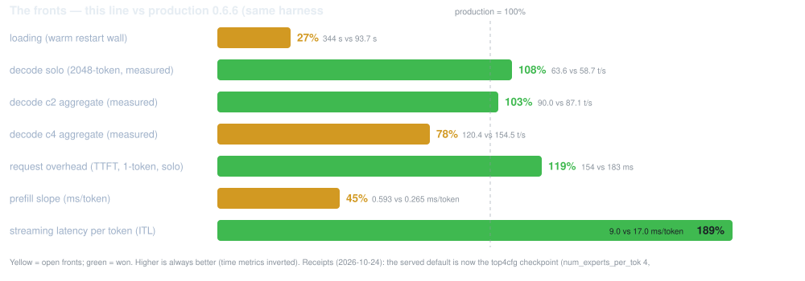

# What differs from the EXL3 recipe, and why

This repo is a **testing line** for the native engine, next to
[MiaAI-Lab's GLM-5.3-Flash-EXL3-2x-DGX-Sparks-TensorFold](https://github.com/MiaAI-Lab/GLM-5.3-Flash-EXL3-2x-DGX-Sparks-TensorFold)
(our production). Both serve the **same checkpoint** — the difference is the
engine and the patch policy. Read this before pointing real traffic at it.
*(Updated 2026-10-28 after the v1.1.8 adoption and the indexer adoption — receipts in
docs/LAUNCH.md and docs/TOOL_EVAL_TESTING.md; this repo's edits are AI-generated, see the
README. The engine is **v1.1.8** (`03d08f1e`, adopted on the receipts-equal battery: gates
ALL PASS, hardmode 92 equal, perf within noise) with **`TF_GLM_INDEX_CUDA=1`** as the
standing default (round 49: the depth ladder −2.6% at 131k → −5.5% at 393k, gates ALL
PASS). The served default is now the **AZ-Focus checkpoint** (topk=8
by design, pristine upstream, no patch) — the **(user) call: hardmode is THE quality
measure, target = beat production's run-level 94 or come close**. The Focus scores **92**
(2 under; its whole gap is TC-38 + TC-80, both `wrong_args` — TC-92/TC-104 fail on
production too); the prior default **top4cfg scored 89** (76% subset — the unretrained
top-4 selector's signature: five extra `wrong_args`/`missing_step` fails) and stays
receipted as the perf leader (**solo 111%, c2 124%, c4 108% of production — CROSSED**,
prefill 78%, loading 37%). The Focus cell's scoreboard (the round-130 head-to-head,
2026-10-31 — the first two-arm duel since the port split, campaign-20261031-200757:
production started FOR TESTING on 8001, ours on main): **loading 98.6% — TAKEN** (95 s vs
93.7), solo **93.2%** (54.9 vs 58.9), c2 **80.5%** (89.0 vs 110.6), c4 **75.2%** (144.9 vs
192.6), ITL **102% — crossed** (16.6 vs 17.0), TTFT overhead **92.5%** (200 vs 185),
**prefill 69%** (the bench pair 1,049 vs 1,518; the slope pair 0.656 vs 0.266 ms/tok),
depth 12/12, hardmode 93 (the standing ceiling); **TTFT at depth (42%) is the open front**
(5,570 vs 2,363 ms — the old 142 was production's cache fully warm from repeated probes;
fresh, the frontier is 2.4×, not 39×). The
marks-policy patch is the fix candidate). The old score rows (92/100 etc.) are formally
cross-version history.
Production's patch series changed
(Mia's 0109-0122 + 0128-0129 + the 0088 NoRoom fix on the python-0.6 tip) and the bench
moved to v3.0.1 — all three serves are re-baselined on it (rounds 35/37). Both engines are
token-deterministic; all §2
gates PASS on both, including the modified checkpoint's battery.)*

## The engine

| | EXL3 recipe (production) | this repo |
| --- | --- | --- |
| Engine | TensorFold **Python 0.6.x** in a PyTorch-based image, plus a 122-patch recipe (Mia's series folded onto the python-0.6 tip, 2026-10-27) | TensorFold **native** (`tensorfold-native`, Zig, no Python) at a pinned commit — **v1.1.8 (`03d08f1e…`, adopted 2026-10-28 on the receipts-equal battery); paged KV mainline** |
| Checkpoint | Mia-AiLab EXL3 4 bpw (~176 GB) stock + DFlash2 drafter | **the AZ-Focus EXL3 variant (the (user) default, 2026-10-27) + DFlash2** — a different checkpoint from production's, chosen on the hardmode bar; the stock and top4cfg Mia cells remain serveable (`MODEL_ID`/`MODEL_REVISION`/`PATCHES` per the README). This line is EXL3 only — the NVFP4 route (NVIDIA's checkpoint, MTP drafts, the v1.0.x receipts) has its own repo (GLM-5.3-Flash-NVFP4-2x-GB10-TensorFold-v1-testing) |
| Code carried locally | a patch series against TensorFold's site-packages | **none** — upstream code, built at a pinned commit |
| Upgrade path | rebase the patch series by hand (see the old repo's REBASE-NOTES) | bump `TF_REF` (or take the default `latest-v1`); prepare rebuilds the image |

The native GLM CUDA family landed upstream in PR
[#804](https://github.com/ashhart/TensorFold/pull/804) (tracked in
[#593](https://github.com/ashhart/TensorFold/issues/593)); the EXL3 two-rank reader and
DFlash2 drafter are #855/#976 and #979, first released in **v1.1.0**.

## Where the two engines stand, measured on this pair (2026-10-23)

Production 0.6.6 and this line have now been measured **with the same harness** (the
qualification campaign's prodqual round):

- **Exactness: parity.** All §2 gates (drafted=plain, resumed=fresh, concurrent=solo,
  seeded sampling) pass on both engines, in the same content form; both are
  token-deterministic at greedy (`choices` byte-identical across runs). Production's
  "drafted replies still equal serial ones" guarantee replicates on the native engine
  with fp8 KV — on dense8 and dense4 both.
- **Decode: parity in steady state.** Solo ~54 t/s (native, dense4fp8) vs ~52 t/s
  (production, derived from its bench rows); aggregate decode rises with streams on
  both (native c4 ~99–110 t/s, production ~104). The long-believed native
  "concurrency cliff" was a bench artifact — tg128 rows divide by total time, so
  prefill polluted them at depth ([ashhart/TensorFold#918](https://github.com/ashhart/TensorFold/issues/918)'s
  cross-backend gap does not show in steady-state decode at this scale).
- **Prefill: production leads ~49%** (1,530 vs 1,025 pp2048). Section profiling
  (TF_GLM_PROF) shows our prompt passes are **90% router+routed** — the gap is the MoE
  expert path in prefill, not attention. This is the main remaining performance
  difference and it is upstream's to close.
- **Loading: TAKEN (round 127/129) — 95 s vs 93.7 s (98.6%)** on v1.2.0 + the tail release — the
  metric front (2026-10-23, the user's bar) is closed. The pre-v1.2 walls were ~265 s. Cause unmeasured: the candidates are the
  load-time packing (dense4/head4 pack at load), the DFlash2 drafter load, or the
  two-rank orchestration; the campaign's knobs phase records the engine's own
  "loaded in" line vs the wall per cell to split them.
- **Quality: production leads 3 points** (95 vs 92 tool-eval, same harness, same seed),
  entirely in the structured-output scenarios (nested schema / enum / multi-tool) —
  an engine-level decoding-path difference, config-independent on our side.
- **Short generations: production leads on TTFT** (1,339 vs 1,999 ms at d0) and on the
  bench's tg-at-depth numbers — which measure prefill+decode together. For chat-style
  short replies production feels faster; for long generations the two engines match.
- **Context: this line is qualified at 524,288** (5 streams, fp8 KV, dense4fp8);
  production's window is the same. The ladder receipts are in
  docs/CONTEXT_512K_PLAN.md.

  

## Honest caveats (as of 2026-10-23)

- **Production remains the recommendation for serving.** It wins prefill, TTFT, short
  generations, and the tool-eval score. This line exists to qualify the native engine
  and it now has the receipts to do that — but "qualified" is not "faster".
- **The native line is still a preview upstream.** The §2 exactness guarantee
  (drafted=plain, resumed=fresh, concurrent=solo) is *our* receipt now, on *our* pair —
  not just upstream's — but upstream's own release notes remain the contract.
- **Vision: upstream has it, we have not run it.** 1.1.0 added `--vision` for GLM EXL3
  two-rank (images and video; video needs libtfvideo). Untested on this pair; anything
  that sends images stays on production until validated.
- **DFlash2 via `--drafter`** (CC BY-NC-ND 4.0, non-commercial) passed automatically
  when the snapshot is present; without it the server falls back to the MTP head (with
  a warning), and `DRAFTS=0` is the serial reference — verified byte-equal in content
  by the gates.
- **TP=2 only**: the native ranks meet over `NCCL_COMM_ID`, and a third rank on a two-host
  cabled pair has no bootstrap interface. The old stack's `start-tp3.sh` stays Python-only.
- **Upstream watch** (docs/ECOSYSTEM.md): #1163/#1211 bring GLM KV paging
  (`TF_KV_PAGES`) — streams become 512-row pages instead of whole windows, which could
  raise the 5-stream admission ceiling; #1080's prefill work is qwen/attention-targeted
  and does not address our MoE-bound prefill gap; #1215's round-class GPU timers are the
  instrumentation pattern to ask for.

## What carries over (and is why this is still worth testing)

- Same topology and wiring: rank 0 on the head, rank 1 over ssh, NCCL over the two CX7 rails,
  the same docker run contract (`--network host`, `/dev/infiniband`, `IPC_LOCK`, memlock).
- The rank checks upstream added are strong: before serving, both ranks verify they run the
  same build, cut and **checkpoint bytes** (sha256 of every shard), and a dead rank stops the
  other within about a second.
- Admission across ranks: every rank's free memory is gathered after loading and the server
  admits by the smallest, naming a rank that refuses — the refusal line prints its own
  arithmetic, which is how the 5-stream ceiling at 512K was established.
- Zero local patches: upstream fixes and speedups land by bumping the version, not by rebasing
  a 106-patch series by hand.
- The qualification harness itself: one command runs the gates, the depth probes, the
  tool-eval, the throughput tables and the ladder, with production guarded and every
  phase receipted — rerunning it after any engine bump is the whole cost of staying honest.
